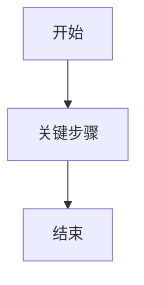

# PRD 模板

原型链接遵循 gitlab-delivery.md，使用普通 Markdown 链接。只引用本次已验证发布的原型 URL，并保留 screen/state 锚点；未发布时明确标记待发布。Markdown 不依赖 prototype-links.js 或 data-prototype-path。

使用以下章节生成 `06-prd.md`，以原生 Markdown 标题、表格和代码围栏呈现。文档应简洁、具体，并可追溯到已确认的业务模型。

正式业务规则、流程和验收标准只使用已确认内容，并追溯到业务模型的决策依据。未决假设单列到第 11 节，不因记录在文档中就成为交付承诺。业务模型确认前需要整理草案时，写入澄清或业务模型 Markdown 的“待确认草案”区域，不提前生成正式 PRD。

## 1. 背景与目标

- 背景：
- 目标：
- 非目标：
- 成功标准：

## 2. 用户与场景

- 目标用户：
- 主要角色：
- 使用场景：
- 关键痛点：

## 3. 范围

- 本期范围：
- 暂不包含：
- 依赖与前置条件：
- 采纳方案与确认依据（存在方案比较时简述主要取舍）：

## 4. 业务对象与状态

| 业务对象 | 关键属性 | 状态 | 状态说明 |
| --- | --- | --- | --- |

## 5. 业务规则

| 编号 | 规则 | 触发条件 | 结果 | 备注 |
| --- | --- | --- | --- | --- |

## 6. 主流程

用编号步骤描述从入口到完成的完整主路径。每一步写清楚参与角色、系统行为、用户操作和状态变化。

## 7. 异常与分支流程

| 场景 | 触发条件 | 系统表现 | 用户可执行动作 | 状态变化 |
| --- | --- | --- | --- | --- |

## 8. 页面与交互要求

| 页面/模块 | 目标 | 主要内容 | 关键操作 | 状态/反馈 |
| --- | --- | --- | --- | --- |

## 9. 权限与可见性

| 角色 | 可见内容 | 可执行操作 | 限制 |
| --- | --- | --- | --- |

## 10. 验收标准

- 

## 11. 风险与待确认问题

- 风险：
- 待确认：

## 12. 流程图

使用 Mermaid。

PRD 内嵌 Mermaid 代码围栏；若目标文档站不支持 Mermaid，则提供仓库内的 SVG/图像与源文件链接，并验证实际构建。每条规则使用稳定 ID，页面要求链接到实际原型 screenId。
